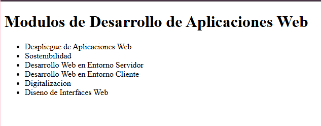

# Despliegue de Aplicaciones Web
## Actividad 1.4: Uso avanzado de GitHub
### Repositorio del Ciclo DAW

Este repositorio contiene las prácticas de control de versiones con **Git** y la plataforma *GitHub*.

> Proyecto centrado en el trabajo colaborativo mediante ramas, gestión de conflictos y despliegue en entornos estáticos.

#### Recursos del proyecto
* Enlace a la plataforma: [GitHub](https://github.com)
* Módulos del ciclo formativo:
  1. Despliegue de Aplicaciones Web
  2. Sostenibilidad
  3. Desarrollo Web en Entorno Servidor
  4. Desarrollo Web en Entorno Cliente
  5. Digitalización
  6. Diseño de Interfaces Web

#### Vista previa del entorno


#### Comando para verificar el estado
```bash
git status